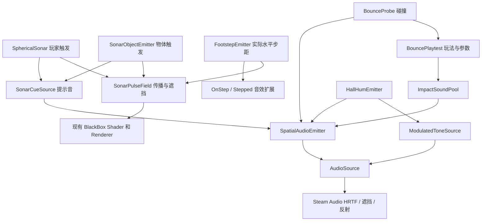

# 声源与声波组件结构

本次拆分保留现有场景、序列化字段和玩法参数。旧场景中的玩法脚本会在运行时自动补齐依赖组件，因此不需要重新搭场景。新物体可以直接挂基础组件。

## 目录与职责

```text
Assets/Scripts/
├── Audio/                              可复用音频能力，不依赖玩法脚本或键盘
│   ├── SpatialAudioEmitter.cs           空间声源、HRTF、遮挡、混响、衰减、额外左右耳增益
│   │   └── SpatialAudioSettings         可序列化的声源设置，音效池内部共享一份
│   ├── ImpactSoundPool.cs               世界坐标的一次性音效池、提前调度、反射尾音、回收
│   ├── ModulatedToneSource.cs           单声道振荡器、正弦波、二次谐波、振幅 LFO
│   ├── SonarCueSource.cs                声波发射提示音；支持音频文件或原有合成 ping
│   └── ProceduralAudioClips.cs          生成 ping / 循环正弦 AudioClip 的纯工厂
├── Gameplay/
│   ├── SonarDistanceSettings.cs         可复用的单次可视声波距离/强度配置
│   ├── FootstepEmitter.cs               按实际水平位移触发脚步波，可选音效与事件
│   ├── SonarPulseField.cs               可视声波传播/遮挡数据，不处理音频、移动、输入
│   ├── SonarObjectEmitter.cs            任意物体的定时/手动声波触发，可组合发射提示音
│   ├── SphericalSonar.cs                玩家声纳输入、HUD、发射冷却、点阵显示开关
│   ├── BouncePlaytest.cs                发球、五个实验开关、输入/HUD、音频参数适配
│   ├── BounceProbe.cs                   小球碰撞计数、消失、飞行音包络
│   └── HallHumEmitter.cs                大厅嗡鸣参数和 H 键，转交基础音源组件
├── Rendering/
│   └── BlackBoxPointCloudFeature.cs     队友的点阵渲染流程
└── Player/
    ├── PlayerController.cs              原有玩家控制
    ├── BlackBoxProximitySource.cs       玩家位置及点阵样式参数
    └── BlackBoxCenterControls.cs        原有样式控制/UI
```



## 四种常用组合

### 1. 物体播放已有音效

给物体添加 `SpatialAudioEmitter`，Unity 会自动补齐 `AudioSource`。设置 `Settings` 中的 HRTF、Reflections、Distance Mode 等，然后由门、机关、敌人等自己的逻辑调用：

```csharp
[SerializeField] SpatialAudioEmitter sound;
[SerializeField] AudioClip clip;

public void Activate() => sound.PlayOneShot(clip);
```

`PlayOneShot` 适合当前位置的短提示音。需要碰撞反射尾音、连续多次在不同位置发声时使用下面的池。

### 2. 任意位置播放碰撞音

创建一个空物体，添加 `ImpactSoundPool`，指定 `Clip`。`Listener` 可指定玩家；不指定时使用活动的 `AudioListener`。

```csharp
[SerializeField] ImpactSoundPool impacts;

public void OnImpact(Vector3 point, float gain)
{
    impacts.PlayAt(point, gain);
}
```

池中的声源保持在碰撞世界坐标，不随持有池的玩家或物体移动。空闲声源优先复用；所有声源繁忙时轮流替换。调度中的声源也算占用，避免同帧多次碰撞误用同一个声源。

`Pre Roll` 默认 25ms 调度等待，同时在音频前补 25ms 静音；这是保留原有瞬态空间化稳定策略。`Tail Seconds` 在音频结尾补静音，让 Steam Audio 有时间输出反射尾音。旧反弹玩法会根据项目 Steam Audio 的实时反射时长自动设置它；独立使用时应覆盖所需尾音时长。

### 3. 固定嗡鸣 / 连续正弦音

给空物体添加 `SpatialAudioEmitter` 和 `ModulatedToneSource`，移动物体即可改变声源位置。

- 纯正弦波：`Second Harmonic = 0`，`LFO Depth = 0`。
- 低频嗡鸣：例如 `Carrier Hz = 110`，`LFO Hz = 0.6`，`LFO Depth = 0.4`。
- 更明显的左右耳差别：在空间声源中设置 `Far Ear Gain < 1`，默认 1 表示仅使用 HRTF；这是额外的玩法增强。
- 更直射：关闭 `Reflections`。
- 调节距离：选择 `Curve`，横轴为米、纵轴为 0–1 增益。

`ModulatedToneSource.Play()` / `Stop()` 控制播放，`Play On Start` 控制首次启动与重新启用时自动播放。每个组件拥有并释放自己的流式音频。音频线程仅读取数值参数，不访问 Unity 物体。

### 4. 任意物体发出可视声波

给物体添加 `SonarObjectEmitter`。将 `Pulse Field` 指向场景中共享的 `SonarPulseField`；现有场景会自动寻找它。指定 `Range`、`Wave Speed`、`Afterglow`、`Interval` 即可。

- `Automatic`：定时发射。
- `EmitNow()`：由机关、脚步、敌人逻辑主动触发。
- `Play Sound`：同时播放发射提示音。
- `Toggle Key = None`：交给其他脚本控制，避免多个物体都响应 C 键。
- 想用自己的发射音：添加 `SonarCueSource` 并指定 `Clip`。

仅触发画面、不需要声音和定时器：

```csharp
[SerializeField] SonarPulseField field;

public void Reveal(Vector3 origin)
{
    field.EmitFrom(origin, 12, 7, .7f);
}
```

`SonarPulseField` 沿用原有六面采样、首个碰撞面遮挡和 Shader 参数；4 个主波槽供主动探测与物体使用，另有 4 个脚步波槽。一个场景共用一份 Field；所有物体指向它，不要为每个声源各建一份。它控制可视声波的直达可见性，声音的反射由 Steam Audio 负责。

## 独立的靠近显影与声波显影

玩家相机的 `SphericalSonar` 提供两个独立开关：

| 开关 | 运行时面板 | 按键 | 效果 |
| --- | --- | --- | --- |
| Proximity Rendering | Proximity reveal | 3 | 原有近距离点阵和轮廓持续可见 |
| Sonar Rendering | Sonar reveal | 4 | 根据声波的到达、遮挡和消退显示点阵和轮廓 |

两个都打开时，最终亮度取两种显影结果的最大值，同一点不会重复叠亮或变粗。两个都关闭时隐藏这两种显影，不改变玩家移动、声波发射、方块自动发射和声音。`R` 只清空声波，不会清除靠近显影。

默认保持 SonarHall 原来的仅声波模式。按 `3` 即可加入靠近显影，按 `4` 可独立关闭声波显影。`1`、`2` 仍控制面点阵、轮廓点，作为两种显影共用的样式开关。Inspector 参数可保存进场景；Play 模式中的切换用于即时比较。

底层参数由 `BlackBoxProximitySource.SetRevealModes(proximity, sonar)` 发布，Shader 使用 `_BlackBoxRevealModes.xy` 合并两种结果。原始 BlackBox 场景的组件默认开启靠近显影，无需挂 `SphericalSonar`。星点跟随靠近显影开关；SonarHall 仍维持原来的星点关闭设置。

## 面点云与声波轮廓的材质

面点云直接使用 `PC_Renderer` 中 `BlackBoxPointCloudFeature.settings` 引用的队友原始材质 `SteppedWhiteDots`，保留 `FaceDensity` 的中心区、外圈和距离分档，以及原来的采样间距。轮廓使用玩家 `SphericalSonar.renderingSettings` 的 `SonarDots`，继续维持 9px 间距。

玩家相机 Inspector → `Spherical Sonar` → `Dot Radius` 统一控制面点和轮廓点的半径，默认 1.5px（720p 参考，直径 3px，随分辨率缩放），滑条范围 0.25–4px。脚本也可直接设置 `sonar.dotRadius`，运行时立即生效。两组绘制通过 MaterialPropertyBlock 使用同一半径，不修改共享材质；如果材质间距被调小，半径统一限制为较小间距的 75%，避免两组被 Shader 截成不同大小。没有 SphericalSonar 的相机继续使用原始材质半径。

两者分别调用同一个现有 Shader 的采样和绘制 Pass，再以最大亮度合成；没有另写点云算法。靠近和声波两个遮罩对面与轮廓都生效。声波与靠近显影直接共用 FaceDensityAt 的完整规则，包括墙面投影、核心区、径向环、距离分档和 OrderedRank。靠近模式使用玩家原点和比例 1；声波按各自固定原点计算，按有效范围相对材质原始范围缩放图案，分别累计轮廓与面亮度。有效范围为 Range 与启用的 Fade End Distance 取较小值。声波在投影圈之外保留最外圈的稀疏档，再由距离衰减完全淡出；靠近模式仍在原投影圈外隐藏。保留到达时间、遮挡、距离衰减与余像，且不受玩家所在位置限制。调面点云的疏密时编辑 `SteppedWhiteDots`；调声波轮廓时编辑 `SonarDots`，避免面点云再被轮廓的稀疏设置一起削弱。

## 距离衰减的归属

`SpatialAudioEmitter` 统一保证只有一个距离模型：

| 模式 | 实际处理 | 对完整音量的控制 |
| --- | --- | --- |
| Physics | Steam Audio 物理距离衰减，Unity 自身曲线恒为 1 | 基础音量保持不变 |
| Linear | minDistance 到 maxDistance 线性降低 | 乘到 AudioSource.volume |
| Curve | 米 → 增益曲线，端点钳制、输出钳制到 0–1 | 乘到 AudioSource.volume |
| DecibelsPerMetre | 从 minDistance 开始，每米降低指定 dB | 乘到 AudioSource.volume |

后三种关闭 Steam Audio 的物理距离衰减，避免重复相乘。`GainAt(distance)` 可用于预览期望的距离增益。物理模式中反射仍按 Steam Audio 模拟；自定义模式会缩放完整输出，包括反射尾音。

旧场景的参数仍在原来的位置：反弹曲线在 `BouncePlaytest`，嗡鸣曲线在 `HallHumEmitter`，方块声波参数在 `SonarObjectEmitter`。这些适配脚本会在运行时把参数交给基础组件，已有物体上应继续修改原脚本中的参数。直接搭建新声源时则修改基础组件的 Inspector。

## 生命周期与维护边界

- `ImpactSoundPool` 负责创建、停止、销毁池中声源，以及生成的尾音 Clip。
- `ModulatedToneSource` 负责生成和销毁流式 Clip；停用时停止播放。
- `SonarCueSource` 仅销毁自己生成的默认 Clip，不销毁引用的音频资产。
- `ProceduralAudioClips` 返回的 Clip 由调用方负责销毁；反弹玩法保留正在使用的旧频率 Clip，销毁玩法对象时统一释放。
- `SpatialAudioEmitter` 配置已有 AudioSource 并应用增益，不生成音频资产，不接收键盘输入。
- 现有控制器仍包含移动、按键和 HUD；后续若接正式交互/UI，可继续拆控制层，音频基础组件无需改动。

## 固定竖线伪影修复

`BlackBoxScreenPoints.shader` 的深度读取和世界坐标还原统一使用实际深度 texel 的中心，法线重建改用整数像素的上下左右邻居。原来的浮点 UV 偏移在部分屏幕列可能取到重复或错位的深度样本，斜视平墙时会被误判成折角，产生固定在屏幕上的竖线。点阵中心、点半径、间距和密度规则不变；采样修正会使边界及密度阈值附近的少量点改变显隐。测试平墙需避免被远裁剪面截断，防止将裁剪边缘当成采样错误。

## 每次声波距离衰减与脚步

`SonarDistanceSettings` 是玩家、物体、脚步共用的可序列化配置类型，每个组件独立持有实例。包含 enabled、fadeStartDistance、fadeEndDistance、falloffPower、pulseStrength，Inspector 在 Distance Settings 下调整。已有玩家/物体平铺字段通过 FormerlySerializedAs 和版本标记迁移，原调用名称仍作为兼容属性保留。现有场景的玩家与方块配置保持原值。

`SonarPulseField.EmitFrom(origin, range, speed, afterglow, settings)` 在发射时打包配置，旧四参数入口仍关闭衰减，原八参数入口也保留。Shader 的 `_SonarPulseDistanceFalloffs` 为每个槽独立记录开始/终止距离、指数及强度。距离从固定发声原点计算，终止距离外硬裁剪；范围内将距离增益乘到原时间淡出上，多个波仍取 max。这是可视探索范围，与音频距离增益分别配置。

`FootstepEmitter` 位于 SonarHall 的 Player 根物体，只读取 `PlayerController` 实际水平位移，不接管输入或移动。默认每 1.5m 一步，最小间隔 0.18s；停步、转头、纯升降、顶墙、输入暂停不触发。单帧位移超过 2m 重置累计，不补发传送脚步。Require Grounded 默认关闭以适配当前自由升降控制；正式贴地行走时可打开。

脚步调用 `EmitFootstepFrom`，起点为胶囊底部上方 0.12m，默认 3m 范围、8m/s、0.3s 余像、0.4–3m 距离衰减、指数 2、强度 0.6。波槽 0–3 供主波使用，4–7 供脚步使用，各自循环，不互相覆盖。Shader 共读取 8 槽；脚步使用 24×24×6 方向采样，主波使用 48×48×6，沿用同一首碰撞面纹理布局。局部脚步的角采样精度较低，薄小物体和边界可能存在误差。

脚步的音效素材暂空，可选 AudioSource + Clips 轮流播放，或从 `onStep` / `Stepped` 收到世界坐标后接音效池。普通 AudioSource 随玩家移动，若希望尾音固定在脚步位置，使用已有 `ImpactSoundPool.PlayAt`。脚步开关在组件 `Emission Enabled` 和按键 6；按键 5 只控制主动探测波。BlackBox 原始场景与共享 Player prefab 未增加脚步行为。

## 验证入口

通过 Unity CLI 在对应场景 Play 模式运行 `script run --file <路径>`：

- `AgentScripts/VerifySonarFaces.cs`：SonarHall；14 项实际画面检查，验证远离玩家的面点激活、脚步槽、到达/消失/硬范围、混合独立性及开关，以及与原核心/外圈图案的逐像素一致性和实际点密度差异，以及脚步高度发波照到地面时的中心密/外圈疏。
- `AgentScripts/VerifyFootsteps.cs`：SonarHall；真实输入下的移动/停步/顶墙/纯升降/传送/贴地选项、事件、按键开关及脚步槽隔离。
- `AgentScripts/VerifyPulseAttenuation.cs`：SonarHall；距离显影递减、硬范围、关闭后逐像素一致、混合独立参数及玩家开关。
- `AgentScripts/VerifyContourBorders.cs`：SonarHall；靠近/声波两种模式各检查 7 个视角的完整平墙没有假轮廓，同时确认真实立方体轮廓仍可见。
- `AgentScripts/VerifyFaceCloud.cs`：SonarHall；在不同距离比较修复后的面点云与队友原始材质的逐像素结果，并检查声波遮罩、轮廓间距独立，以及统一半径对面点和轮廓点的实际缩放效果。
- `AgentScripts/VerifyRevealModes.cs`：SonarHall；对四种组合进行实际画面像素验证，包括已有声波、无声波、清空声波和隐藏画面时继续发射。
- `AgentScripts/VerifyAudioComponents.cs`：SonarHall；独立音源、衰减归属、波场解耦、并发调度、生命周期。
- `AgentScripts/VerifyObjectSonar.cs`：SonarHall；方块声源、世界位置、玩家发射、实际音频输出。
- `AgentScripts/VerifyFiveSwitches.cs`：CircularHall；五个玩法开关、小球反弹和飞行音、实际距离音量。
- `AgentScripts/VerifyHallHumAndCurve.cs`：CircularHall；LFO、曲线编辑、反弹和嗡鸣独立。
- `AgentScripts/VerifyDirectHum.cs`：CircularHall；实际左右声道输出、远近增益。

本次验证：脚步行为 16 项、衰减与实际画面 19 项、共享角色控制 16 项、显影开关 10 项全部通过，C# 编译无错误或警告。截图检查包括脚步专用槽的近处显影、3m 外全黑和余像消失。

像素测试报告输出在 `/tmp/Sound2-*.json`；脚步与共享角色测试直接返回结构化结果，不会成为游戏运行代码。
